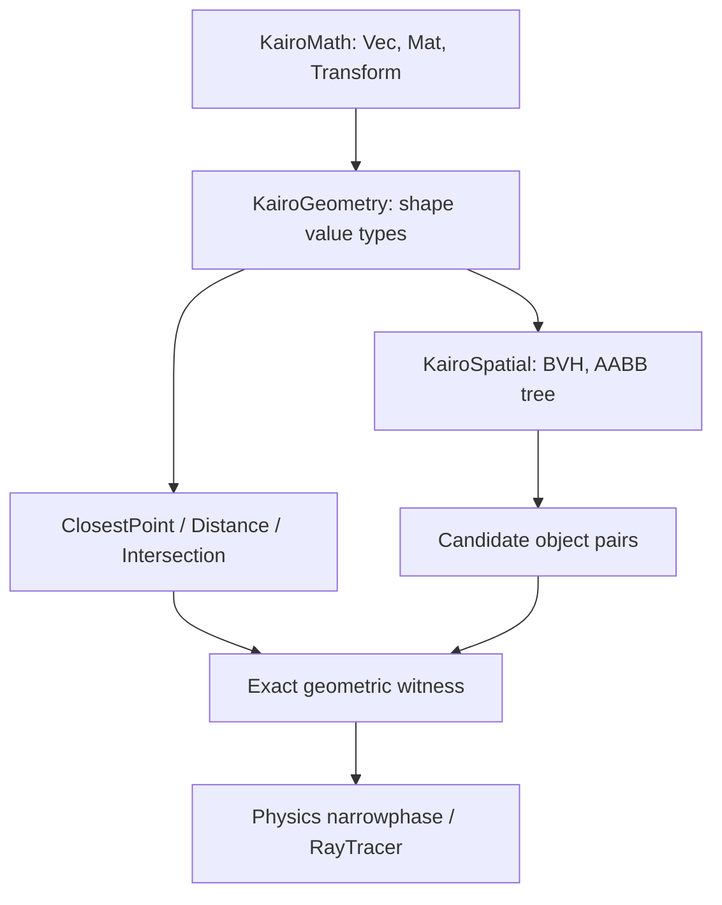

# From coordinates to geometric queries

This walkthrough connects the public APIs of [KairoGeometry](SOURCE_READING_ORDER.md) into one learning path. Read it together with code and tests, not as an accuracy certificate.

## 1. Geometry is not a physics world

[KairoMath](https://github.com/swayam8624/KairoMath/blob/docs/teaching-walkthrough-20261121/docs/SOURCE_READING_ORDER.md) defines vectors, matrices, quaternions and transformations. KairoGeometry turns those values into *shapes* and *queries*. KairoSpatial uses bounding volumes to accelerate the search for likely intersections; KairoPhysicsEngine and KairoRayTracer consume specific distance or hit results.

The central distinction is that **broadphase overlap is only a candidate**, not a surface contact, intersection point or collision response.

## 2. A ray, a line and a segment have different domains

A ray is `P(t)=O+D*t` with `t>=0` ([Ray.cppm](../Ray.cppm)). A line admits any signed `t` ([Line.cppm](../Line.cppm)). A segment between A and B uses `P(t)=A+(B-A)*t` with `t in [0,1]` ([Segment.cppm](../Segment.cppm)).

The closest-point parameter is a projection. With direction D, it is `dot(P-O,D)/dot(D,D)` before clamping to the permitted domain. If D is unit length, the ray/line parameter is distance along it; if not, t is only a scaling parameter. A segment's normalized t is a fraction of segment length. This difference matters in ray-triangle hit distances, tool snapping, and capsule contacts.

A zero-length segment must have a sensible fallback instead of dividing by zero. The segment-segment closest-points operation also clamps both parameters so the witness points never escape the finite edges.

## 3. Planes, signed distance and normals

[Plane.cppm](../Plane.cppm) represents `dot(N,P)+d=0`. If N is a unit normal, `dot(N,P)+d` is the signed distance in world-length units: positive on the normal side, negative behind. Projecting a point onto the plane subtracts its signed distance times N. Reflection flips only the normal component.

[Triangle.cppm](../Triangle.cppm) uses vertices A, B, C. `cross(B-A,C-A)` is unnormalized and has magnitude twice the area. Its direction depends on winding. A unit triangle normal divides by its magnitude; a degenerate triangle requires guarding. Barycentric coordinates express a point as weights on the three vertices. Their sum is one; a valid interior point has weights within the accepted tolerance. A point can lie on the *triangle's supporting plane* while falling outside the triangle, so plane distance alone is not triangle containment.

## 4. Sphere and capsule signed distance

A sphere with center C and radius r has signed distance `|P-C|-r` ([Sphere.cppm](../Sphere.cppm)). A capsule sweeps that sphere along a segment: its signed distance is `distance(P,closest point on axis)-r` ([Capsule.cppm](../Capsule.cppm)). Negative values indicate an interior point, zero the surface, positive exterior space.

These formulas make it possible to build contact candidates from closest points. A capsule with equal axis endpoints behaves like a sphere. Beware that **PhysicsMath's capsule inertia** is a separate approximate mass model; a valid capsule distance formula does not imply exact inertial response.

## 5. Why AABB and OBB are both useful

An axis-aligned bounding box stores Min and Max per axis ([AABB.cppm](../AABB.cppm)). Overlap can be checked by comparing three coordinate intervals. This is very fast and makes AABB practical for BVH and dynamic-tree pruning. Rotating an AABB does not make it a true rotated AABB: `TransformAABB` constructs a new enclosing axis-aligned bound, potentially larger than the object.

An oriented bounding box ([OBB.cppm](../OBB.cppm)) instead stores a center, three approximately orthogonal unit axes, and half-extents. World-to-local projection turns many OBB closest-point tests into local box clamping.

For OBB–OBB overlap, the separating axis theorem considers each box's face normals and cross products of basis axes. If *any* valid axis separates their projected intervals, the boxes do not intersect. Near-parallel axes require care and an epsilon policy.

## 6. Ray intersection algorithms

[Intersection.cppm](../Intersection.cppm) contains several different mathematical procedures:

- **Ray–sphere** substitutes the ray equation into a sphere equation and solves a quadratic, taking a nonnegative root.
- **Ray–plane** divides a signed plane offset by `dot(N,D)` and rejects parallel or backward hits.
- **Ray–triangle** computes a determinant and barycentric coordinates (Möller–Trumbore style); the barycentric conditions exclude hits outside the finite face.
- **Ray–AABB** intersects parameter intervals across x, y and z slabs; for a direction nearly parallel to an axis, its origin must already lie inside that slab.
- **Ray–capsule** must account for the cylindrical swept portion and both rounded ends.

The returned optional hit encodes *whether* a geometric witness was found; it does not automatically encode a physically correct contact manifold, material response or visibility from a real GPU.

## 7. Frustum and camera culling

[Frustum.cppm](../Frustum.cppm) extracts six inward-facing planes from a view-projection matrix. Point containment requires nonnegative signed distance to all six. To conservatively test a sphere, AABB or OBB, reject only when a plane proves the entire bound is outside. Passing culling means *potentially visible*, not a guarantee that any pixel will survive rasterization, depth testing, occlusion or material evaluation.

Frustum extraction depends on KairoMath's row-major data storage, column-vector multiplication and depth convention. A storage-layout mismatch or an OpenGL versus Vulkan clip-depth mismatch can cause false culling even when the math appears plausible.

## 8. ClosestPoint, Distance and Intersection are layered APIs

[ClosestPoint.cppm](../ClosestPoint.cppm) asks for a nearest witness on a shape. [Distance.cppm](../Distance.cppm) measures separation, often from that witness. [Intersection.cppm](../Intersection.cppm) returns binary overlap or richer ray-hit evidence. Squared distances avoid square roots in comparisons; signed distances have shape-specific inside/outside meaning. Mixing these conventions can produce incorrect collision thresholds.

## 9. Verification

The repository contains three distinct numeric test paths: [GeometryTests.cpp](../tests/GeometryTests.cpp) with its own assertion harness, [smoke.cpp](../tests/smoke.cpp) returning a failing source line, and [CertificationTests.cpp](../tests/CertificationTests.cpp) checking sampled inputs from a fixed RNG seed. [VisualTests.cpp](../visual/VisualTests.cpp) generates SVG evidence; [server.py](../visual/server.py) serves those static files. Visual output helps understanding but is not a replacement for assertions or adversarial geometric tests.

Read the [CMake configuration](../CMakeLists.txt) to determine which tests are enabled and linked for the current build. No local compilation or new certification run has been performed for these teaching edits.

## 10. Hands-on work

Derive a ray-plane intersection, then implement it with nonunit ray directions and parallel cases. Derive point-to-segment projection and test degenerate segments. Construct a rotating OBB, compare its enclosing AABB size at several angles and explain why broadphase produces false positives. Finally, build a triangle intersection test with both windings, coplanar cases and tiny triangles; record the numeric tolerance and expected result.

When reading an API, ask: **what shape is represented, what domain constrains its parameters, which coordinate frame applies, how are degeneracies handled, which module consumes the result, and which test proves the claim?**
